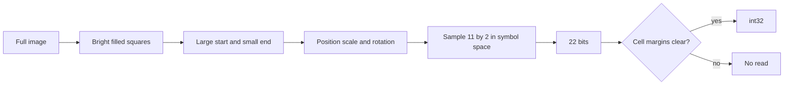

# 22-bit card code reader

Build a from-scratch reader that finds the custom 11×2 symbol anywhere in the frame, at any in-plane rotation, decodes its 22 bits exactly, and returns them as an int32 in the range 0 to 4,194,303. The two finder squares supply position, scale, and rotation.

Labeled images live under `datasets/<name>/`, one `labels.csv` beside that batch's `images/` folder. See `STYLE.md`. No standard QR library is used: the symbol is a custom grid.

## Symbol and integer

- Two rows, eleven columns, 22 modules. White module = `1`, black = `0`.
- Large start square at the top-left. Smaller end square at the bottom-right.
- Read row-major: top row left to right, then bottom row. The leftmost bit has weight `2^21`.
- `value = sum(bit[i] * 2^(21 - i))` for `i` in `0..21`. Stored as a Python `int` that fits in int32.
- All-ones code equals `2^22 - 1` = **4,194,303**. The sample bits `0001101110000000010001` equal **450577** (`0x6E011`). The upper 10 bits of the int32 stay 0.
- Column count is a constant. The reader never infers 16 columns from marker spacing.



## Position and rotation

The symbol is not assumed to sit in the footer, to be upright, or to be the only bright object in a fixed crop. Search the whole image.

The two squares are a pose, not just a crop hint.

- The large square is the start marker. The small square is the end marker. Their area ratio separates them from data modules.
- The line from the start center to the end center is the symbol diagonal. In symbol space that diagonal has a known angle, `atan2(symbolHeight, symbolWidth)`, because the start square is top-left and the end square is bottom-right.
- Image rotation is that measured diagonal angle minus the known diagonal angle. That covers a full turn, including 90, 180, and 270.
- A square's own edge angle repeats every 90 degrees, so it is only a check. The small square picks the correct quadrant: after the rotation above, it must land on the end-marker cell.
- Cell size is the diagonal length divided by the known diagonal length in cell units. Origin is the start square. Sampling uses symbol-local coordinates mapped into the image with an affine transform (`cv2.getAffineTransform` or a 2×3 matrix). The reader samples along the rotated axes. It does not rotate the whole photo first and it does not require the rows to be horizontal.

A strong camera tilt, where the card is a trapezoid rather than a rotated rectangle, is a separate case. In-plane rotation and position are solved by the finder pair. Tilted photos can still use a card-corner warp before the finder search, but the Kyber render and the pose tests must pass without a hardcoded footer crop.

## Pipeline

1. **Find square candidates on the full image.** Adaptive or local threshold so white modules separate from a dark background. On the Kyber render, white peaks near 197 and black sits near 46, so a fixed cutoff of 128 is not the rule. Morphological open with a kernel smaller than the black gap keeps the start square from merging into neighboring white cells. Keep connected components that are filled and nearly square, at any position and any edge angle.
2. **Pair start and end.** A candidate pair is a larger square and a smaller square whose area ratio and separation match the symbol. Reject pairs whose diagonal does not place the small square on the end-marker cell after the rotation above. Polarity comes from the finders: their interior color is `1`.
3. **Sample the grid in symbol space.** Map each of the 22 cell centers through the affine pose. Sample the middle half of each cell. Read the same grid three times with a sub-cell shift along the symbol axes. Accept the integer only when all three readings match and every cell mean is clearly nearer to the finder color or the background color. Otherwise return no read.
4. **Optional card warp.** If the card corners are visible and the photo is tilted, warp to a rectangle first, then run the same finder search. This step is an aid for perspective. It is not how rotation or position is determined.

## Files to add

- `src/ccr/scanner.py` — symbol constants, full-frame square search, pose from the finder pair, grid sample, confidence gate.
- `src/ccr/preprocess.py` — optional card-corner warp for tilted photos. The decoder still runs if this warp is skipped.
- `src/ccr/synthesize.py` — render a symbol from a 22-bit string, then place it at a chosen scale, position, and rotation on a larger canvas.
- `tests/test_scanner.py` — loads every `datasets/*/labels.csv` and asserts one exact result per row. Expected integers live in the CSV, not in the Python file.
- `src/ccr/__main__.py` — print bits and int32 for one image.
- `datasets/<name>/labels.csv` — one label sheet per batch. Image paths are relative to that CSV.
- `datasets/<name>/images/` — the image files named by that sheet.

Libraries: OpenCV, NumPy, pytest. Albumentations is optional later for blur and brightness copies. pyzbar, zxing, and pylibdmtx stay unused.

## Label file

One CSV is the only place a card is tied to an int32. The test runner does not hardcode expected values.

File: `datasets/<name>/labels.csv`. The sheet and its `images/` folder share that folder. The format is specified in `STYLE.md`.

UTF-8, comma-separated, header required. Paths in `image` are relative to the CSV file. A line whose first character is `#` is a comment, so groups of cards can be titled by hand. Blank lines are skipped. The same `image` path twice is an error, so a card cannot carry two ids.

Columns, in this order:

- `image` — required. Example: `images/Kyber-II Optics.png`
- `value` — required. Decimal int32 for a successful read, from 0 through 4194303. The word `none` means the image must return no read.
- `bits` — optional. Exactly 22 characters of `0` and `1`. When present, `int(bits, 2)` must equal `value`. This lets you check the integer against the bit string while labeling. Leave it empty when you only know the id.
- `note` — optional free text. The test ignores it.

```csv
image,value,bits,note
images/all_zero.png,0,0000000000000000000000,synthetic
images/all_ones.png,4194303,1111111111111111111111,synthetic max int32
images/Kyber-II Optics.png,450577,0001101110000000010001,rendered card
images/blank_card.png,none,,no symbol
```

To label a new card: put the file in that batch's `images/` folder, add a row, and write the int in `value`. If you also know the bits, fill `bits`. The loader rejects a row where those two disagree, before the decoder runs, so a typo in the sheet is not blamed on the reader.

Each row is one pytest case. A decoded int must equal `value`. A `none` row must be a no-read. A wrong integer fails. A refusal on a row that has a value is counted separately from a wrong integer.

## Tests that prove exactness

Build the decoder against synthetic crops before the full card. Every case below is a row in the CSV, not an assert written into the test file.

- All-zero equals 0. All-ones equals 4,194,303.
- Walking-1: 22 images, one bit set in each. A one-cell grid shift fails this set.
- The attached symbol and `Kyber-II Optics.png` both equal 450577.
- Scaled copies from about 20 px to 60 px per cell.
- The same code placed in the corners and the center of a larger canvas, not only in a tight crop.
- The same code rotated by 15, 45, 90, 180, and 270 degrees, plus one arbitrary angle such as 20 degrees. Each of those still equals 450577.
- Combined cases: one image that is scaled, shifted, and rotated together.
- Images with no symbol return no read.

Report two numbers: exact matches among returned integers, and refusals on images that do contain a symbol. A wrong integer fails the test. A refusal is counted separately. That split is what makes an exactness target meaningful.

## Implementation order

1. Constants and the bit-to-int function, with unit checks for 0, 4,194,303, and 450577. Label sheets live in `datasets/<name>/labels.csv`. The loader checks each row before any image is decoded.
2. Synthetic renderer writes images plus CSV rows, then the cropped decoder must match those rows, including the walking-1 set.
3. Finder pose on a tight upright crop, then the same crop translated and rotated. Those cases must return 450577 before any card warp exists.
4. Full card: `Kyber-II Optics.png` returns 450577 with the symbol found by the squares, not by a footer crop.
5. Confidence gate and the no-symbol cases. Card-corner warp stays optional for tilted photos.
